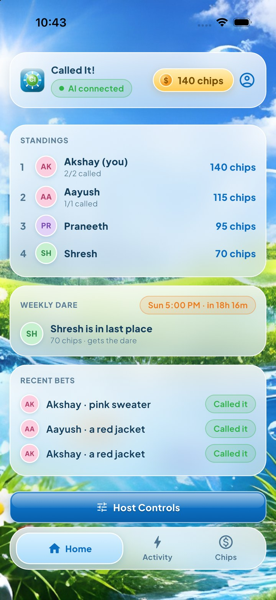
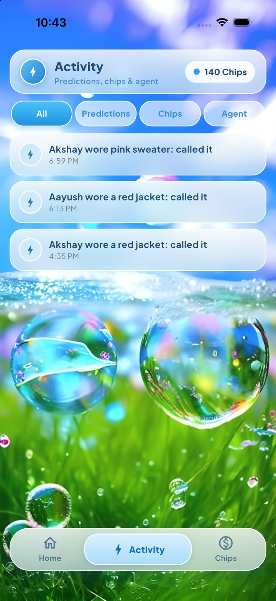
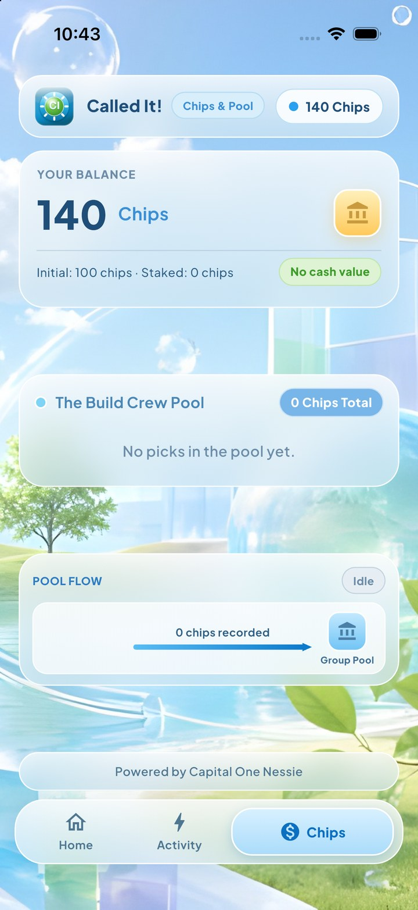
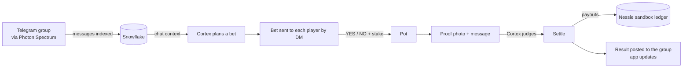

<div align="center">

# 🎯 Called It!

### Your group chat's AI friend that bets on what you'll do next.

*Observe → Predict → Settle*


<br>

 &nbsp;
 &nbsp;


</div>

---

## What is it?

**Called It!** is an AI participant that lives in your friend group chat. It reads the conversation, notices what people are up to, and turns it into a prop bet the whole group can play, using free, fictional chips.

> *"Will Akshay wear a red jacket today?"*  ·  everyone stakes chips into a shared pot

A proof photo plus a follow-up message settles the bet, the AI judges it, and the pot is paid out to the people who called it. There is no real money anywhere: chips are play money with no cash value.

The game runs in Telegram. The Flutter app is the scoreboard: standings, the live bet, the pot, a real activity feed and the weekly dare.

## How a round works



1. **Observe.** The bot indexes group messages in Snowflake.
2. **Predict.** Snowflake Cortex reads this group's indexed chat (only this group's) and picks who the bet is about and what they'll wear or do. Whatever the chat keeps repeating wins. The bet text is assembled from real data: the question, a real quote from the chat, and the group's real record. If the chat gives nothing specific, the bot asks for more instead of inventing a bet.
3. **Play.** Each player gets a private DM, greeted by their own name, with the bet. Players pick YES or NO and stake chips into the pot. Optionally (`DECOY_ENABLED=true`) the person the bet is about gets a decoy bet about someone else, so the real one stays a surprise.
4. **Prove.** The target sends a photo, then a message. Cortex decides whether the message sounds like a real proof or a stall. Anyone in the group can also say it happened, didn't happen, or cancel it.
5. **Settle.** The pot is split among the correct picks, balances update, and the result lands in the group chat. If nobody proves it, the bet times out (`BET_MINUTES`) and settles as "no".

### Weekly dare (optional)

With `WEEKLY_DARE=true`, every Sunday at 21:00 (`TZ`, server timezone by default) the player with the fewest chips in each group gets a dare written by Cortex and posted to the group. The Home screen shows who is in last place and a countdown.

## Tech used

| Layer | What it does here |
|---|---|
| **Photon Spectrum** (`spectrum-ts`) | Messaging layer. Receives group and DM events and sends the bot's replies. |
| **Telegram** | The real group chat (Photon's free and Pro iMessage lines are shared, so they can't host a group). |
| **Snowflake Cortex** | `SNOWFLAKE.CORTEX.COMPLETE` powers bet generation, chat replies, intent classification, proof judging and dares. Chat history and outcomes are stored in Snowflake tables; the app reads past bets from there. |
| **Capital One Nessie** | Sandbox accounts per player plus a pot account. Stakes and payouts are mirrored as withdrawals and deposits. |
| **Flutter** | Frutiger Aero-style app for iOS (simulator) and web: Home, Activity, Chips, plus Host Controls, Result, Insights and Settings screens. |
| **Node + TypeScript** | The bot and a small HTTP API (`/api/state`) the app reads. |

## The app

Frosted glass, glossy buttons and bubble wallpapers. Every number comes from the backend, so the app never edits balances itself.

- **Home:** standings (ranked by chips, with each player's record), the live bet when one is running, the weekly dare card and recent bets.
- **Activity:** a real timeline built from your Snowflake history and live events.
- **Chips:** your balance, the current pool and the pool flow.
- **Host Controls, Result, Insights, Settings:** reached from Home. If you are the target of a live bet, the app shows you the decoy question, not the real one.

The tab bar animates: the active tab grows, the old one shrinks and the page slides. A render test (`flutter test`) loads every screen at three phone sizes, with and without data, and fails on any overflow.

## What's real and what's simplified

| Piece | Status |
|---|---|
| Telegram group chat, DMs, `/bet`, `/chips`, group yes/no/cancel | Working |
| Chat indexed in Snowflake, Cortex-written bets, replies, dares | Working |
| Stakes, pot, payouts, standings | Working (the bot's own tally is the source of truth) |
| App state | Reads the live bot: players, chips, real past bets, live bet, pool, results, activity |
| Proof judging | Judged from the caption text that follows the photo. The image itself is not analyzed. |
| Nessie | Stakes and payouts are mirrored to sandbox accounts. Nessie has no transfer endpoint, so its balances don't change; the bot's tally is authoritative. |
| Win-rate odds | Start at 50/50 until real results accumulate. |
| Host Controls | Developer tools. "Add Test Picks" adds made-up players' picks. |
| Message history | The bot only sees messages sent while it is running. |

**Known limits**
- Game state isn't saved mid-bet, so restarting the bot during a round loses that round.
- Only one bet runs at a time across all groups.
- Anyone in the group can settle a bet.
- The API has no authentication, so run it on a private network.

## Run it

**Requirements:** Node 22+, a Telegram bot token, Photon Spectrum project credentials, a Snowflake account, a Nessie API key.

```bash
git clone https://github.com/side-swifter/called-it-hack-nc.git
cd called-it-hack-nc
npm install
cp .env.example .env     # fill in your keys (never commit .env)
npm run dev              # bot + API on :8787
```

Add the bot to a Telegram group, turn off privacy mode in BotFather, have everyone tap Start on the bot (it can't DM people who haven't), and type `/bet`.

| Variable | Purpose |
|---|---|
| `TELEGRAM_BOT_TOKEN`, `SPECTRUM_PROJECT_ID`, `SPECTRUM_PROJECT_SECRET` | Messaging |
| `SNOWFLAKE_ACCOUNT`, `SNOWFLAKE_USERNAME`, `SNOWFLAKE_PASSWORD`, `SNOWFLAKE_WAREHOUSE`, `SNOWFLAKE_DATABASE`, `SNOWFLAKE_SCHEMA` | Cortex and history |
| `NESSIE_API_KEY` | Sandbox ledger |
| `BET_MINUTES` | Minutes before an unproven bet settles as "no" |
| `DECOY_ENABLED`, `WEEKLY_DARE`, `TZ` | Optional decoy bet, weekly dare and its timezone |
| `HOST_ID`, `API_PORT` | Which player the app treats as you, and the API port (default 8787) |

**Flutter app (iOS simulator):**

```bash
cd called_it_app
flutter pub get
open -a Simulator
flutter run -d "<simulator name>" --dart-define=API=http://<bot-host>:8787
```

**Flutter app (web):** `flutter build web --release`, and the bot serves it at `http://<bot-host>:8787`.

**Tests:** `npm test` (game rules) and `cd called_it_app && flutter test` (screen layout).

## Project layout

```
src/messaging/vibebet.ts   group + DM game logic
src/vibebet/brain.ts       Snowflake Cortex: bets, replies, judging, chat index, history
src/vibebet/chips.ts       chip balances, pot, Nessie mirroring
src/vibebet/settle.ts      payout and settlement
src/vibebet/dare.ts        weekly dare schedule and storage
src/vibebet/snapshot.ts    state served to the app
src/vibebet/api.ts         HTTP API + static web build
called_it_app/             Flutter app
docs/                      screenshots and the design mockups the app was built from
```

## Notes

- Chips are fictional currency with no cash value and no redemption.
- Built at a hackathon. Not production software.
