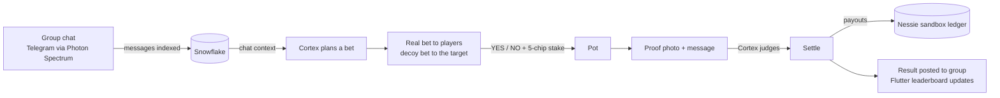
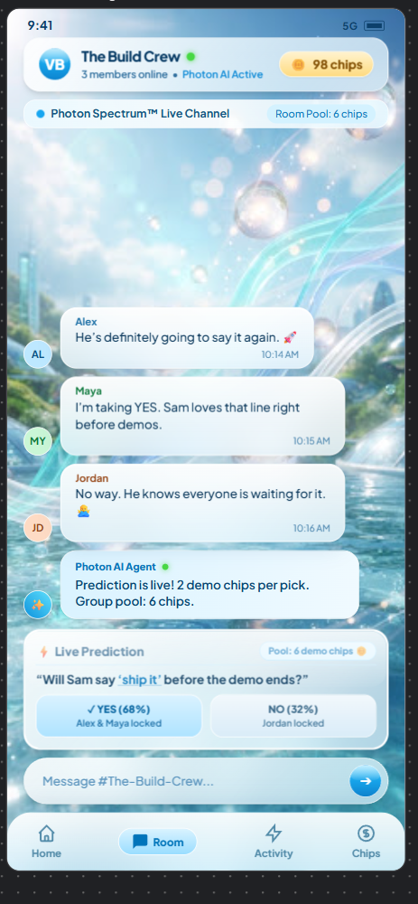
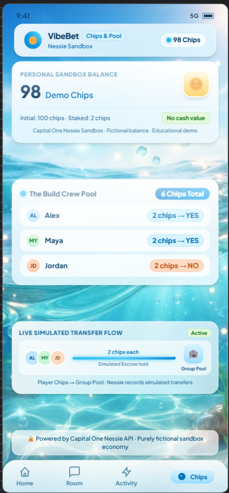
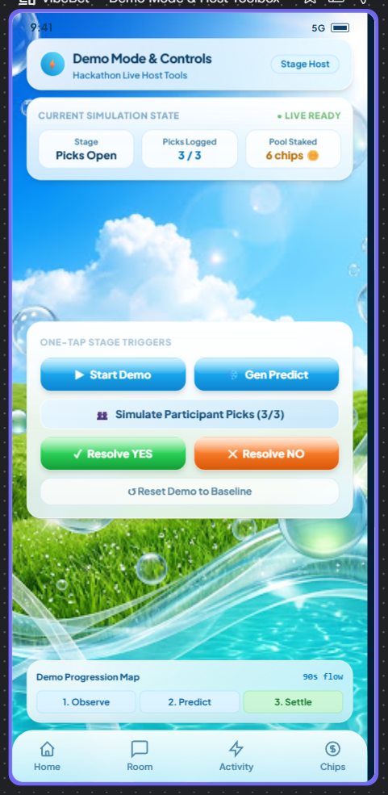
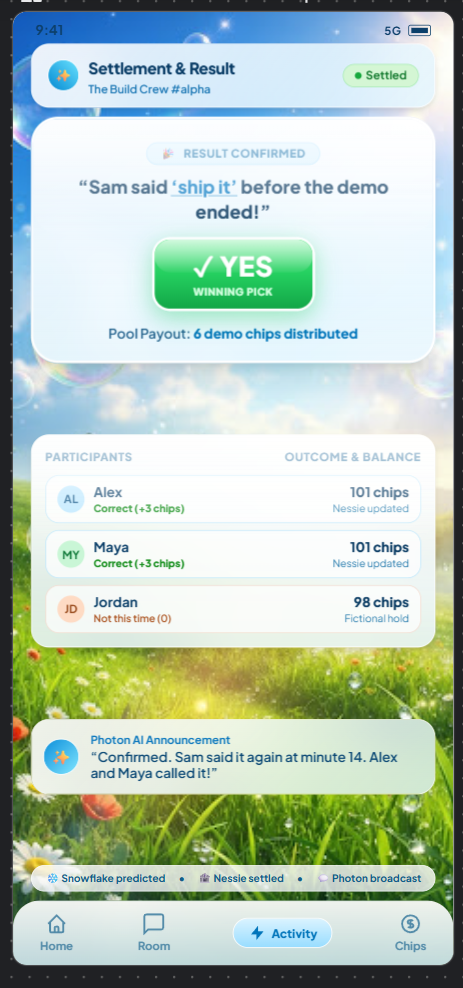

<div align="center">

# 🎯 Called It

### Your group chat's AI friend that bets on what you'll do next.

*Observe → Predict → Settle*


</div>

---

## What is it?

**Called It** is an AI participant that lives in your friend group chat. It reads the conversation, notices what people are up to, and turns it into a prop bet the whole group can play, using free, fictional chips.

> *"Will Akshay wear a red jacket today?"*  ·  **YES 68%**  ·  **NO 32%**  ·  2 chips per pick

Everyone stakes into a shared pot. A proof photo plus a follow-up message settles the bet, the AI judges it, and the pot is paid out to the people who called it. There is no real money anywhere: chips are play money with no cash value.

**The twist:** the person the bet is about gets a *decoy* bet about someone else, so the game can't be spoiled.

## How a round works



1. **Observe.** The bot indexes group messages in Snowflake.
2. **Predict.** Snowflake Cortex reads recent chat and writes a harmless, answerable bet about what someone will wear.
3. **Play.** Each player gets a private DM. Everyone but the target sees the real bet, and the target sees a convincing decoy. Players reply yes or no and stake chips into the pot.
4. **Prove.** The target sends a photo, then a message. Cortex decides if the message sounds like a real proof or a stall.
5. **Settle.** The pot is split among the correct picks, balances update, and the result lands in the group chat.

## Tech used

| Layer | What it does here |
|---|---|
| **Photon Spectrum** (`spectrum-ts`) | Messaging layer. Receives group and DM events and sends the bot's replies. |
| **Telegram** | The real group chat (Photon's free and Pro iMessage lines are shared, so they can't host a group). |
| **Snowflake Cortex** | `SNOWFLAKE.CORTEX.COMPLETE` powers bet generation, chat replies, intent classification and proof judging. Chat history and outcomes are stored in Snowflake tables. |
| **Capital One Nessie** | Sandbox accounts per player plus a pot account. Stakes and payouts are mirrored as withdrawals and deposits. |
| **Flutter** | Frutiger Aero mobile app (iOS simulator and web): Home, Room, Chips, Activity, Host controls, Result and more. |
| **Node + TypeScript** | The bot and the small HTTP API (`/api/state`) that the app reads. |

## The app

A Frutiger Aero-style companion app: frosted glass, glossy buttons, bubbles. Every number comes from the backend; the app never edits balances itself.

| Room | Chips & Pool |
|:---:|:---:|
|  |  |
| **Host / Demo Mode** | **Settlement & Result** |
|  |  |

*These images are the design mockups the app was built from.*

**Screens:** Home, Room (live chat feed + prediction card), Chips (balance, pool, transfer flow), Activity (timeline), Host controls (start, generate, simulate picks, resolve YES/NO, reset), Settlement result, AI Insights, Prediction details, Settings, Green Moments.

## What's real and what's simplified

| Piece | Status |
|---|---|
| Telegram group chat, DMs, `/bet`, `/chips` | Working |
| Chat indexed in Snowflake, Cortex-written bets and replies | Working |
| Real bet + decoy bet per player, stakes, pot, payouts | Working (the bot's own tally is the source of truth) |
| Proof judging | Judged from the caption text that follows the photo. The image itself is not analyzed. |
| Nessie | Stakes and payouts are mirrored to sandbox accounts. Nessie has no transfer endpoint, so balances there don't change; the bot's tally is authoritative. |
| Win-rate odds | Start from sample history until real results accumulate. |
| App "Gen Predict" | Uses Cortex when the group has enough chat; otherwise returns a sample question marked `source: scripted`. |
| Message history | The bot only sees messages sent while it is running. |

## Run it

**Requirements:** Node 22+, a Telegram bot token, Photon Spectrum project credentials, a Snowflake account, a Nessie API key.

```bash
git clone https://github.com/side-swifter/called-it-hack-nc.git
cd called-it-hack-nc
npm install
cp .env.example .env     # fill in your keys (never commit .env)
npm run dev              # bot + API on :8787
```

Key environment variables: `SPECTRUM_PROJECT_ID`, `SPECTRUM_PROJECT_SECRET`, `TELEGRAM_BOT_TOKEN`, `SNOWFLAKE_ACCOUNT`, `SNOWFLAKE_USERNAME`, `SNOWFLAKE_PASSWORD`, `SNOWFLAKE_WAREHOUSE`, `NESSIE_API_KEY`. Add the bot to a Telegram group, turn off privacy mode in BotFather, and type `/bet`.

**Flutter app (iOS simulator):**

```bash
cd called_it_app
flutter pub get
open -a Simulator
flutter run -d "<simulator name>" --dart-define=API=http://<bot-host>:8787
```

**Flutter app (web):** `flutter build web --release` and the bot serves it at `http://<bot-host>:8787`.

## Project layout

```
src/messaging/vibebet.ts   group + DM game logic
src/vibebet/brain.ts       Snowflake Cortex: bets, replies, judging, chat index
src/vibebet/chips.ts       chip balances, pot, Nessie mirroring
src/vibebet/snapshot.ts    state served to the app
src/vibebet/api.ts         HTTP API + static web build
called_it_app/             Flutter app
docs/design/               design mockups
```

## Notes

- Chips are fictional demo currency with no cash value and no redemption.
- Built at a hackathon. Not production software.
